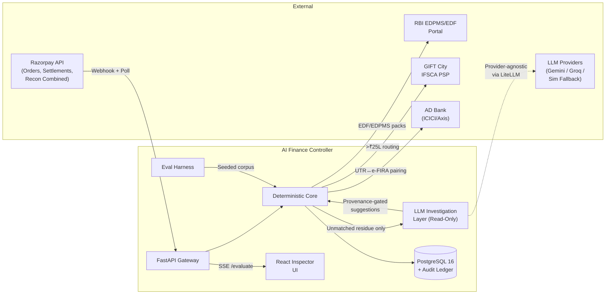
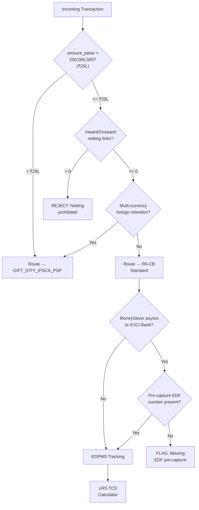
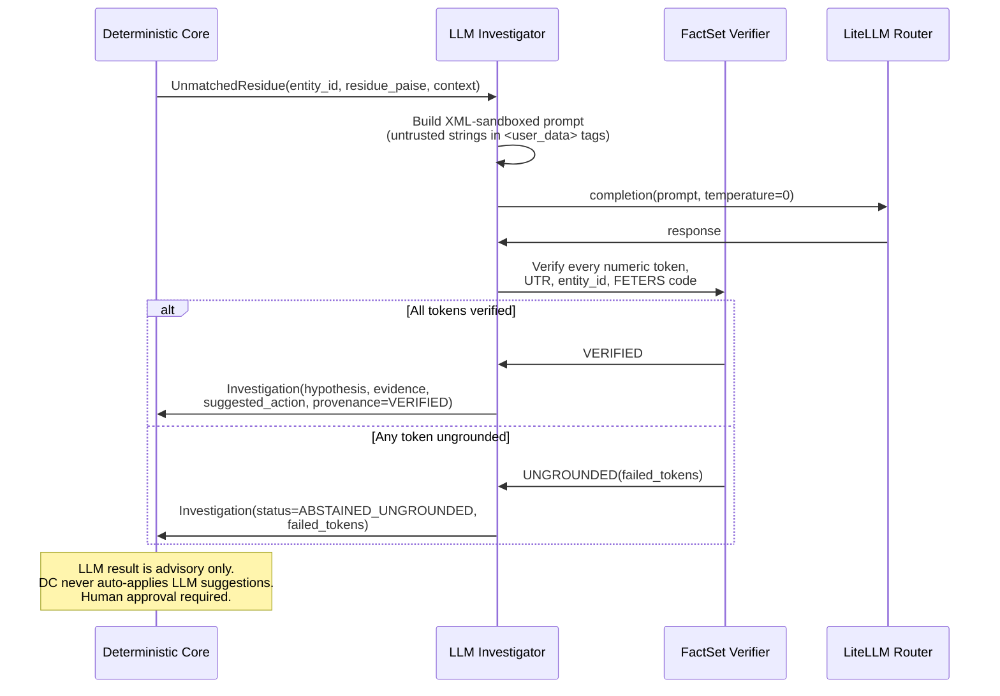
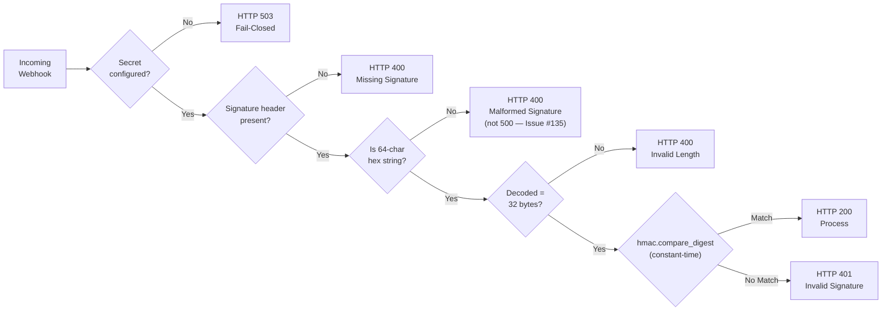
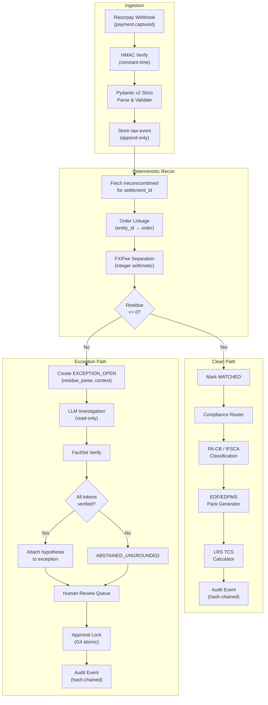
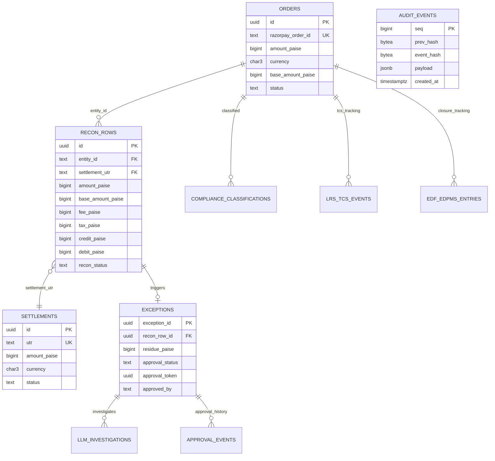

# ARCHITECTURE.md — Cross-Border Multi-Currency Settlement & Compliance Controller

> **Version:** 1.0.0 · **Date:** 2026-11-22 · **Track:** Razorpay AI Builder Program — Track 04: AI Finance Controller
> **Classification:** Internal — Razorpay Submission Artifact

---

## Table of Contents

1. [High-Level Design (HLD)](#1-high-level-design)
2. [Low-Level Design (LLD)](#2-low-level-design)
3. [Data Flow Diagrams](#3-data-flow-diagrams)
4. [Deterministic vs. LLM Boundary Table](#4-deterministic-vs-llm-boundary-table)
5. [Failure Modes & Recovery](#5-failure-modes--recovery)
6. [Trade-Offs & Design Decisions](#6-trade-offs--design-decisions)
7. [Evaluation Harness (`eval/`)](#7-evaluation-harness)
8. [Deployment Topology](#8-deployment-topology)

---

## 1. High-Level Design

### 1.1 System Context



### 1.2 Core Principles

| # | Principle | Enforcement |
|---|-----------|-------------|
| **P1** | **Money is an integer** | `int64` paise/cents everywhere. Pydantic `StrictInt`, SQL `BIGINT`, no `float`/`NUMERIC` for money. |
| **P2** | **Deterministic-first** | All recon, FX separation, fee calc, TCS slabs, compliance routing — zero LLM. |
| **P3** | **LLM is a read-only investigator** | LLM cannot write to DB, approve exceptions, or emit unverified numbers. |
| **P4** | **Append-only audit** | Hash-chained `audit_events`. No UPDATE/DELETE on the table. `REVOKE` enforced at DB role level. |
| **P5** | **Fail-closed on ambiguity** | Any non-zero residue → `EXCEPTION_OPEN`. Any ungrounded LLM claim → `ABSTAINED_UNGROUNDED`. |

### 1.3 Module Decomposition

```
┌──────────────────────────────────────────────────────┐
│                   FastAPI Gateway                     │
│  webhook_receiver · recon_api · approval_api · sse   │
├──────────────────────────────────────────────────────┤
│              Deterministic Core (G2 isolated)         │
│  ┌────────────┐ ┌──────────┐ ┌───────────────────┐  │
│  │ Recon      │ │ FX/Fee   │ │ Compliance Router │  │
│  │ Engine     │ │ Separator│ │ (PA-CB / IFSCA /  │  │
│  │            │ │          │ │  EDF / LRS TCS)   │  │
│  └────────────┘ └──────────┘ └───────────────────┘  │
│  ┌────────────┐ ┌──────────┐ ┌───────────────────┐  │
│  │ Settlement │ │ Approval │ │ Audit Chain       │  │
│  │ Matcher    │ │ Lock     │ │ Writer            │  │
│  └────────────┘ └──────────┘ └───────────────────┘  │
├──────────────────────────────────────────────────────┤
│          LLM Investigation Layer (read-only)          │
│  ┌────────────┐ ┌──────────┐ ┌───────────────────┐  │
│  │ Residue    │ │ FactSet  │ │ Prompt Sandbox    │  │
│  │ Investigator│ │ Verifier│ │ (XML-tag isolate) │  │
│  └────────────┘ └──────────┘ └───────────────────┘  │
├──────────────────────────────────────────────────────┤
│           Infrastructure & Persistence                │
│  PostgreSQL 16 · LiteLLM Router · Docker Compose     │
└──────────────────────────────────────────────────────┘
```

---

## 2. Low-Level Design

### 2.1 Recon Engine

**Input:** Razorpay `/v1/settlements/recon/combined` JSON (polled or webhook-triggered).

**Algorithm (deterministic, O(n log n)):**

1. **Ingest & Validate:** Parse each recon row via Pydantic v2 strict model. Reject `NaN`, `Infinity`, negative amounts at the boundary. All `amount`, `base_amount`, `fee`, `tax`, `credit`, `debit` stored as `BIGINT` paise.
2. **Order Linkage:** Join on `entity_id` → `orders.id`. If order not found, mark `RECON_ORPHAN`.
3. **FX/Fee Separation** (see §2.2).
4. **Settlement Matching:** Group by `settlement_utr`. Assert `SUM(credit) - SUM(debit) == settlement.amount` per UTR. Any non-zero residue → `EXCEPTION_OPEN`.
5. **Compliance Classification:** Route each matched transaction through the compliance router (§2.3).
6. **Audit Emit:** Append hash-chained event for every state transition.

### 2.2 FX & Fee Separator

All calculations are **integer arithmetic in paise**. No floats at any stage.

#### International Card Path (3% + 18% GST on fee = 3.54% total)

```
gross_txn_paise      = order.amount                    # from POST /v1/orders
fee_paise            = (gross_txn_paise * 300) // 10000  # 3% truncated
gst_on_fee_paise     = (fee_paise * 1800) // 10000       # 18% of fee truncated
total_deduction      = fee_paise + gst_on_fee_paise
net_credit_expected  = gross_txn_paise - total_deduction
residue              = recon_row.credit - net_credit_expected
# residue != 0 → EXCEPTION_OPEN
```

#### MoneySaver Export Account Path

```
if gross_txn_paise < 10_000_000_00:   # < ₹1,00,000 (in paise)
    fee_paise       = 100_000          # ₹1,000 flat
    gst_on_fee      = 18_000           # ₹180
    total_deduction = 118_000          # ₹1,180
else:
    fee_paise       = (gross_txn_paise * 100) // 10000   # 1%
    gst_on_fee      = (fee_paise * 1800) // 10000        # 18% of fee
    total_deduction = fee_paise + gst_on_fee

# Crossover breakeven: ₹33,333.33 (3,333,333 paise) where
# card_total_deduction == moneysaver_flat_deduction
```

> [!IMPORTANT]
> The FX conversion rate is **extracted from Razorpay's `forex_rate` field** or computed as `base_amount / amount` using integer division with remainder tracking. We NEVER infer the FX rate backwards from the net credited INR amount, as that conflates FX with fees/GST.

### 2.3 Compliance Router



### 2.4 LRS TCS Calculator (Section 394(1) FY 2026-27)

**Inputs:** `pan_hash`, `fy_start` (April 1), `fy_end` (March 31), `purpose_code`, `remitter_type`, cumulative `usd_outward_ytd`.

| Purpose Category | Threshold | Rate Below | Rate Above | Cap |
|---|---|---|---|---|
| Sec 129/80E loan-funded education | — | 0% | 0% | USD 250,000 |
| Self-funded education / medical | ₹10,00,000 | 0% | 2% | USD 250,000 |
| Overseas tour packages | None | 2% | 2% | USD 250,000 |
| General / GIFT City investments | ₹10,00,000 | 0% | 20% | USD 250,000 |
| `NRI_NRO` (FEMA Remittance of Assets) | — | 0% | 0% | USD 1,000,000/FY |
| `CORPORATE_FEMA` | — | 0% | 0% | N/A |

```
# Pseudocode — all arithmetic in paise, threshold in paise
threshold_paise = 10_00_000_00  # ₹10,00,000

if remitter_type in ('NRI_NRO', 'CORPORATE_FEMA'):
    tcs_paise = 0
elif purpose == 'LOAN_EDUCATION':
    tcs_paise = 0
elif purpose == 'OVERSEAS_TOUR':
    tcs_paise = (txn_paise * 200) // 10000  # flat 2%
elif purpose in ('SELF_EDUCATION', 'MEDICAL'):
    excess = max(0, cumulative_ytd_paise + txn_paise - threshold_paise)
    tcs_paise = (excess * 200) // 10000     # 2% on excess
else:  # GENERAL / GIFT_CITY_INVESTMENT
    excess = max(0, cumulative_ytd_paise + txn_paise - threshold_paise)
    tcs_paise = (excess * 2000) // 10000    # 20% on excess
```

### 2.5 EDF/EDPMS Closure Pack Generator

| Field | Rule |
|---|---|
| **Bulk self-declaration** | Invoices ≤ ₹10 lakh grouped quarterly |
| **FCY realization window** | 9 months from shipment/service date |
| **INR realization window** | 12 months from shipment/service date |
| **Overdue risk flag** | >1 year from realization deadline |
| **UTR ↔ e-FIRA/FIRS pairing** | `settlement_utr` matched to AD bank FIRA reference |

### 2.6 LLM Investigation Layer



#### FactSet Verifier Contract

The `FactSetVerifier` performs verbatim matching on **every** factual claim the LLM emits:

| Token Type | Verification Source | Match Rule |
|---|---|---|
| `amount` (any currency) | `recon_rows`, `orders` table | Exact integer match |
| `entity_id` | `orders.razorpay_order_id` | Exact string |
| `settlement_utr` | `settlements.utr` | Exact string |
| FETERS purpose code | `feters_codes` reference table | Exact code + description |
| FX rate | `forex_rates` table | ±0 tolerance (exact rational) |
| Date/timestamp | Source records | ISO-8601 exact match |

**Any single verification failure → entire LLM response is `ABSTAINED_UNGROUNDED`.**

### 2.7 Approval Lock (G4)

```sql
-- Atomic single-use approval (see schema.sql for full DDL)
UPDATE exceptions
SET    approval_status   = :new_status,
       approved_by       = :user_id,
       approved_at       = now(),
       approval_token    = NULL
WHERE  exception_id      = :eid
  AND  approval_token    = :tok
  AND  approval_status   = 'PENDING';
-- Application asserts ROWCOUNT == 1; else HTTP 409 Conflict
```

### 2.8 Webhook Security



> [!WARNING]
> The signature format validation (steps S3–S4) MUST occur **before** `hmac.compare_digest`. Passing a malformed hex string directly to HMAC comparison would raise an unhandled exception → HTTP 500, leaking timing information. This is the exact bug described in `razorpay-mcp-server` Issue #135.

---

## 3. Data Flow Diagrams

### 3.1 End-to-End Settlement Flow



### 3.2 Data Model Relationships



---

## 4. Deterministic vs. LLM Boundary Table

> [!CAUTION]
> Violation of this boundary table is a **build-breaking** CI failure via `import-linter`.

| # | Function | Layer | Rationale |
|---|----------|-------|-----------|
| 1 | Multi-currency recon matching | **DETERMINISTIC** | Exact integer arithmetic; zero tolerance for approximation |
| 2 | FX rate extraction & validation | **DETERMINISTIC** | Rate is a known datum, not inferred |
| 3 | Fee calculation (Card 3.54%, MS 1.18%) | **DETERMINISTIC** | Published Razorpay rate card; integer math |
| 4 | MoneySaver flat-fee floor logic | **DETERMINISTIC** | ₹1,180 below ₹1L; exact crossover at ₹33,333.33 |
| 5 | Settlement UTR grouping & balance assertion | **DETERMINISTIC** | `SUM(credit) - SUM(debit) == settlement.amount` |
| 6 | PA-CB ₹25L cap enforcement | **DETERMINISTIC** | Regulatory hard cap; binary comparison |
| 7 | Inward/outward netting prohibition | **DETERMINISTIC** | `SUM(links) == 0` assertion |
| 8 | GIFT City IFSCA PSP routing | **DETERMINISTIC** | Rule-based on amount + currency retention flags |
| 9 | EDF pre-capture number validation | **DETERMINISTIC** | Presence check on structured field |
| 10 | EDPMS quarterly bulk grouping | **DETERMINISTIC** | Date + amount bucketing |
| 11 | 9-month / 12-month realization window tracking | **DETERMINISTIC** | Date arithmetic |
| 12 | LRS TCS slab calculation (all 6 slabs) | **DETERMINISTIC** | Published Section 394(1) rates; integer math |
| 13 | PAN-cumulative FY outward tracking | **DETERMINISTIC** | Running sum per hashed PAN per FY |
| 14 | UTR ↔ e-FIRA/FIRS pairing | **DETERMINISTIC** | Exact string match |
| 15 | Webhook HMAC signature verification | **DETERMINISTIC** | Cryptographic; constant-time |
| 16 | Approval lock (G4) | **DETERMINISTIC** | SQL conditional update; rowcount assertion |
| 17 | Audit hash chain computation | **DETERMINISTIC** | SHA-256; append-only |
| 18 | PAN redaction (Luhn check + HMAC-SHA256) | **DETERMINISTIC** | Cryptographic; no AI |
| 19 | Pydantic input validation (reject NaN/Inf/negative) | **DETERMINISTIC** | Schema validation at boundary |
| 20 | Unmatched residue investigation | **LLM** (read-only) | Mangled SWIFT `:71F:` deductions, split payouts |
| 21 | Purpose-code suggestion for ambiguous transactions | **LLM** (read-only) | Requires contextual reasoning over free text |
| 22 | SWIFT message field interpretation | **LLM** (read-only) | Unstructured banking message parsing |
| 23 | Exception hypothesis generation | **LLM** (read-only) | Natural language explanation for human reviewer |

> **Ratio: 19 deterministic : 4 LLM-assisted (read-only, provenance-gated)**

---

## 5. Failure Modes & Recovery

| ID | Failure Mode | Detection | Impact | Mitigation | Recovery |
|----|---|---|---|---|---|
| **F1** | Razorpay API timeout/5xx | HTTP status + retry budget | Recon delay | Exponential backoff (3 retries, 1s/2s/4s). Circuit breaker after 5 consecutive failures. | Automatic retry; alert after circuit open. |
| **F2** | FX rate missing from recon payload | `forex_rate IS NULL` check | Cannot separate FX from fees | Mark `FX_RATE_MISSING`. Do NOT infer from net amount. | Manual FX rate entry via approval flow. |
| **F3** | Non-zero residue after fee separation | `residue_paise != 0` | Potential mismatch | `EXCEPTION_OPEN` → LLM investigation → human queue. | Approval lock (G4) for resolution. |
| **F4** | LLM provider outage (all providers) | LiteLLM timeout/error on all configured providers | No investigation for exceptions | Exceptions remain `PENDING_INVESTIGATION`. `DATA_MODE=sim` fallback returns canned hypotheses. | Auto-retry when provider recovers; no data loss. |
| **F5** | LLM hallucination / ungrounded claim | `FactSetVerifier` token mismatch | Bad hypothesis | `ABSTAINED_UNGROUNDED` — hypothesis discarded entirely. | Human reviews raw exception without AI assistance. |
| **F6** | Double-approval race condition | `rowcount != 1` after conditional UPDATE | Duplicate approval | HTTP 409 Conflict returned; first writer wins. | Idempotent — no state corruption possible. |
| **F7** | Audit chain corruption | `h_i != SHA256(h_{i-1} \|\| payload \|\| ts)` | Tamper detected | Alert + halt processing. `REVOKE UPDATE, DELETE` prevents in-DB tampering. | Forensic investigation; restore from WAL backup. |
| **F8** | Webhook secret unset | `os.environ.get('RAZORPAY_WEBHOOK_SECRET') is None` | Cannot verify webhooks | HTTP 503 fail-closed on ALL webhook requests. | Configure secret; restart. |
| **F9** | Malformed webhook signature | Regex/length check before HMAC | Issue #135 vector | HTTP 400 (not 500). No timing leak. | Caller corrects signature format. |
| **F10** | PostgreSQL connection pool exhaustion | Connection timeout errors | API degradation | Pool ceiling = 20 (configurable). Health check endpoint. | Auto-reconnect; alert on sustained exhaustion. |
| **F11** | PAN-cumulative overflow (>USD 250K) | Threshold comparison in LRS calculator | Regulatory breach risk | Hard block + `COMPLIANCE_BREACH_BLOCKED` status. | Cannot proceed without compliance officer override. |
| **F12** | SQLite WAL fallback inconsistency | `DATABASE_URL` scheme detection | Reduced ACID guarantees | SQLite WAL mode; single-writer serialization. | Acceptable for CI only; production requires PostgreSQL. |

---

## 6. Trade-Offs & Design Decisions

### 6.1 Integer Arithmetic vs. Decimal

| Option | Pros | Cons | Decision |
|---|---|---|---|
| `int64` paise | Zero rounding error; fastest comparison; trivially serializable | Requires explicit subunit conversion at I/O boundary | **✅ Chosen (G1)** |
| `decimal.Decimal` | Familiar to accountants; arbitrary precision | Slower; JSON serialization ambiguity; still needs rounding policy | ❌ Rejected |
| `float64` | Native JSON type | Rounding errors (0.1+0.2 ≠ 0.3); catastrophic for finance | ❌ Prohibited |

### 6.2 LLM Integration Strategy

| Option | Pros | Cons | Decision |
|---|---|---|---|
| No LLM at all | Simplest; zero hallucination risk | Cannot investigate unstructured residue causes | ❌ Insufficient for edge cases |
| LLM with write access | Could auto-resolve exceptions | Hallucination → financial data corruption | ❌ Prohibited (G3) |
| LLM read-only + FactSet gate | Assists investigation; zero corruption risk | Requires FactSet verifier maintenance; slower resolution | **✅ Chosen** |

### 6.3 Database: PostgreSQL vs. SQLite

| Context | Choice | Rationale |
|---|---|---|
| Production / Docker | PostgreSQL 16 | ACID, row-level locking, `REVOKE` for audit protection, `FOR UPDATE` for approval locks |
| CI / Zero-Docker | SQLite WAL | Acceptable for test assertions; no `REVOKE` enforcement (tested via application-layer checks) |

### 6.4 Webhook Verification Order

**Decision:** Validate signature format (hex length, byte length) BEFORE `hmac.compare_digest`.

**Rationale:** Prevents unhandled `ValueError` from `bytes.fromhex()` on malformed input, which would surface as HTTP 500 and leak timing information. This directly addresses `razorpay-mcp-server` Issue #135. The cost is two extra string checks (negligible).

### 6.5 Audit Hash Chain vs. Database Triggers

| Option | Pros | Cons | Decision |
|---|---|---|---|
| Application-layer hash chain | Portable; testable in SQLite CI; explicit | Requires discipline; must be called on every write | **✅ Chosen** |
| PostgreSQL trigger-based | Automatic; cannot be bypassed in-DB | Not portable to SQLite; harder to unit test | ❌ Rejected (but recommended as production hardening) |

### 6.6 LRS TCS: Rounding Policy for Integer Division

**Decision:** Truncation (`//` floor division) for all TCS calculations.

**Rationale:** Section 394(1) does not specify rounding direction. Truncation is conservative (undercollects by at most 1 paisa per transaction), which is the safer direction for the merchant. Any discrepancy is auditable. The alternative (ceiling/round-half-up) risks overcollection which requires refund processing.

---

## 7. Evaluation Harness

### 7.1 Directory Structure

```
eval/
├── corpus/
│   ├── seed_20261122.json          # 200-record seeded corpus
│   ├── strata.yaml                  # Stratification config
│   └── generators/
│       ├── happy_path.py            # 110 clean records
│       ├── ambiguous_residue.py     # 40 records with non-zero residue
│       ├── regulatory_failure.py    # 30 policy violation scenarios
│       └── adversarial.py           # 20 adversarial/outage cases
├── judges/
│   ├── recon_accuracy_judge.py      # Exact-match recon verification
│   ├── compliance_judge.py          # Regulatory classification accuracy
│   ├── llm_grounding_judge.py       # FactSet verification rate
│   └── audit_integrity_judge.py     # Hash chain verification
├── artifacts/
│   └── run_<seed>.jsonl             # Persisted raw judge votes
├── configs/
│   ├── model_fleet.yaml             # Model configurations
│   └── eval_config.yaml             # Eval parameters
├── Makefile                         # eval targets
└── README.md
```

### 7.2 Corpus Stratification

| Stratum | Count | Description | Key Assertions |
|---|---|---|---|
| **Happy Path** | 110 | Clean multi-currency settlements (USD, EUR, GBP, AED, SGD) | 100% deterministic match; 0 residue; correct fee/TCS |
| **Ambiguous Residue** | 40 | Non-zero residue from SWIFT `:71F:` deductions, partial payouts, FX rate discrepancy | LLM investigation triggered; FactSet gate exercised |
| **Regulatory Failure** | 30 | >₹25L PA-CB breach, missing EDF, netting attempt, LRS cap exceeded, overdue realization | Correct compliance routing; hard blocks enforced |
| **Adversarial / Outage** | 20 | Malformed webhooks, NaN amounts, prompt injection in SWIFT fields, LLM provider outage, double-approval race | Fail-closed behavior; no data corruption |

### 7.3 Key `make` Targets

```makefile
# Spend-free dry run (DATA_MODE=sim, no LLM API calls)
make eval-dry SEED=20261122

# Full eval with live LLM providers
make eval-live SEED=20261122

# Model fleet comparison
make eval-fleet SEED=20261122 MODELS="gemini-2.0-flash,llama-3.1-70b,mixtral-8x7b"

# Artifact inspection
make eval-report SEED=20261122
```

### 7.4 Judge Contract

Each judge emits a JSONL line per record:

```json
{
  "record_id": "TXN_001",
  "stratum": "happy_path",
  "judge": "recon_accuracy",
  "verdict": "PASS",
  "expected_residue_paise": 0,
  "actual_residue_paise": 0,
  "latency_ms": 12,
  "model": "deterministic",
  "seed": "20261122",
  "timestamp": "2026-11-22T20:30:00Z"
}
```

### 7.5 Scoring Metrics

| Metric | Target | Formula |
|---|---|---|
| **Deterministic Match Rate** | 100% on clean records | `matched / (matched + mismatched)` for happy_path stratum |
| **False Match Rate** | 0% | `false_positive_matches / total_matches` |
| **Exception Detection Rate** | 100% | `correctly_flagged_exceptions / total_exceptions` |
| **FactSet Grounding Rate** | ≥90% of LLM responses | `grounded_responses / total_llm_responses` |
| **Compliance Classification Accuracy** | 100% | `correct_classifications / total_classifications` |
| **Audit Chain Integrity** | 100% | `valid_hash_links / total_events` |
| **Approval Lock Safety** | 100% | `0 double_approvals / total_approval_attempts` |

---

## 8. Deployment Topology

### 8.1 Docker Compose (Development / Demo)

```yaml
# Illustrative — not application code
services:
  api:
    build: ./backend
    ports: ["8000:8000"]
    environment:
      DATABASE_URL: postgresql://ctrl:ctrl@db:5432/controller
      DATA_MODE: sim
      RAZORPAY_WEBHOOK_SECRET: ${RAZORPAY_WEBHOOK_SECRET}
    depends_on:
      db: { condition: service_healthy }

  db:
    image: postgres:16-alpine
    environment:
      POSTGRES_DB: controller
      POSTGRES_USER: ctrl
      POSTGRES_PASSWORD: ctrl
    volumes: ["pgdata:/var/lib/postgresql/data"]
    healthcheck:
      test: ["CMD-SHELL", "pg_isready -U ctrl"]
      interval: 5s

  ui:
    build: ./frontend
    ports: ["3000:3000"]
    environment:
      NEXT_PUBLIC_API_URL: http://localhost:8000
      NEXT_PUBLIC_DATA_MODE: sim

volumes:
  pgdata:
```

### 8.2 CI Pipeline (GitHub Actions)

```
┌─ lint ──────────────────────────────────────────────┐
│  ruff check · mypy --strict · import-linter          │
│  pip-audit · gitleaks                                │
├─ test ──────────────────────────────────────────────┤
│  pytest -x --tb=short (SQLite WAL fallback)          │
│  hypothesis (property-based: G1 conservation)        │
├─ eval-dry ──────────────────────────────────────────┤
│  make eval-dry SEED=20261122 (zero API spend)        │
│  Assert: 100% deterministic match on happy_path      │
│  Assert: 0% false matches                            │
│  Assert: 100% audit chain integrity                  │
├─ security ──────────────────────────────────────────┤
│  Webhook HMAC format validation test suite            │
│  Prompt injection adversarial test suite              │
│  PAN redaction coverage assertion                     │
└─────────────────────────────────────────────────────┘
```

---

> **End of ARCHITECTURE.md**
